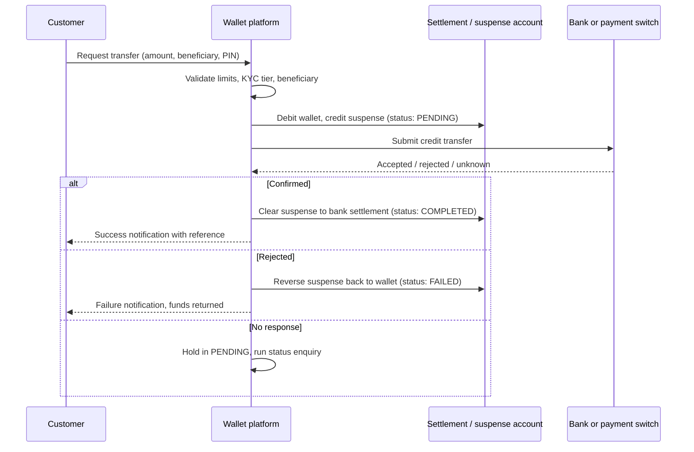

# Digital Wallet to Bank Transfer

An educational guide to **wallet-to-bank transfers** on a digital wallet or mobile wallet platform: how a customer moves money out of an e-wallet into a bank account, what happens between the wallet ledger and the bank rails, and the controls that stop money going missing in between. Written for operators, fintechs, and product teams looking at platforms in the [EVD System](https://evdsystem.com/) and [MoboGage](https://evdsystem.com/about-mobogage/) family.

---

## What Is a Wallet-to-Bank Transfer?

A **wallet-to-bank transfer** (sometimes called "cash-out to bank", "withdraw to account", or "wallet payout") debits a customer's stored-value wallet and credits a bank account held in the customer's name or a beneficiary's name. The reverse flow, **bank-to-wallet**, loads the wallet from a bank account and is usually treated as a top-up.

The customer sees a single button. Behind it, two very different systems have to agree: the wallet platform, which updates its ledger in milliseconds, and the bank or payment switch, which may confirm in seconds, hours, or the next business day depending on the rail.

### Typical use cases

- **Consumers** moving salary or remittance proceeds from the wallet into a savings account
- **Merchants** sweeping daily wallet takings into a business bank account
- **Agents** rebalancing float by sending excess e-money back to the bank
- **Businesses** paying suppliers or staff who prefer to be paid into a bank account

---

## How It Works

### Core components

| Component | Responsibility |
|-----------|----------------|
| **Beneficiary service** | Stores and validates bank accounts (account number or IBAN, bank code, name) |
| **Limits and risk engine** | Applies per-transaction, daily, and monthly caps by KYC tier, plus fraud rules |
| **Wallet ledger** | Debits the customer and books the amount to a suspense or in-transit account |
| **Payout connector** | Talks to the bank API, instant payment switch, or batch file interface |
| **Status tracker** | Polls or receives callbacks, and handles timeouts and unknown outcomes |
| **Reconciliation** | Matches wallet-side payouts with bank statements and settlement reports |

See [docs/design-notes.md](./docs/design-notes.md) for deeper notes on state handling and reconciliation.

---

## Choosing a Payout Rail

| Rail type | Typical speed | Practical notes |
|-----------|---------------|-----------------|
| **Instant payment scheme** | Seconds | Best customer experience; needs a direct or sponsored connection and 24/7 operations |
| **Bank API (single bank)** | Seconds to minutes | Simple when most customers bank with one partner; other banks may route slower |
| **Domestic transfer (batch / ACH-style)** | Same day to next business day | Lower cost, but customers need clear "expected by" messaging |
| **Card push (where supported)** | Near real time | Useful when the customer has a card but the account number is unknown |

Many platforms support more than one rail and route by bank, amount, and time of day.

---

## Design Considerations

- **Never debit without a home for the money.** Book the debit into a named suspense or in-transit account, not into thin air, so every pending transfer is visible on the balance sheet.
- **Treat "unknown" as its own state.** A timeout is not a failure. Reversing too early and then receiving a late success means paying twice.
- **Name matching.** Where the scheme supports it, check that the beneficiary name matches the account before sending. It catches typos and some scams.
- **First-time beneficiary friction.** A cooling-off period or extra OTP on new beneficiaries is a common, low-cost defence against account takeover.
- **Fees shown upfront.** Show the fee and the amount the bank will receive before the PIN prompt.
- **Cut-off times and holidays.** Batch rails stop at cut-off; the app should say when the money will arrive.
- **Idempotency.** Every payout request carries a unique reference so retries never create duplicates at the bank.

MoboGage's EVD System platform includes digital wallet and mobile money capabilities, with cash-in, cash-out, transfers, and reversals handled on the same ledger as voucher and top-up services.

---

## FAQ

**What is a wallet-to-bank transfer?**
A transfer that debits a digital wallet balance and credits a bank account, usually through a bank API, an instant payment scheme, or a batch transfer file.

**Why does a wallet-to-bank transfer sometimes stay "pending"?**
The wallet has debited the customer but the bank has not yet confirmed. This is normal on batch rails, and on instant rails it usually means a timeout that needs a status check before any reversal.

**Should the wallet reverse a failed bank transfer automatically?**
Yes, when the bank gives a clear rejection. When the outcome is unknown, the safer approach is to query the status first and only reverse once failure is confirmed.

**How is this different from a wallet cash-out at an agent?**
Agent cash-out turns e-money into physical cash through an agent. Wallet-to-bank keeps the money digital and moves it into the banking system.

**How does this relate to MoboGage / EVD System?**
MoboGage provides wallet and mobile money capabilities within EVD System. See [wallet cash-in, cash-out, transfers and reversals](https://evdsystem.com/evd-software/wallet-cash-in-out-transfers-and-reversals/) and [about MoboGage](https://evdsystem.com/about-mobogage/).

---

## Glossary (short)

- **Suspense / in-transit account** — a ledger account holding funds that have left the wallet but not yet reached the bank
- **Payout rail** — the network or method used to deliver the money to the bank account
- **Beneficiary** — the bank account holder receiving the transfer
- **Status enquiry** — a follow-up call asking the bank what happened to a transfer
- **Idempotency key** — a unique reference that makes retries safe

---

## Further Reading / Related Industry Resources

- [Wallet cash-in, cash-out, transfers and reversals](https://evdsystem.com/evd-software/wallet-cash-in-out-transfers-and-reversals/) — how MoboGage handles wallet money movement
- [Mobile money platform with merchant payment](https://evdsystem.com/mobile-money-platform-with-merchant-payment/) — wallet and mobile money product context
- Related repo: [mobile-wallet-platform-guide](https://github.com/iwtglobal/mobile-wallet-platform-guide) — the building blocks of a mobile wallet platform

---

## License

Documentation in this repository is provided under the MIT License. See [LICENSE](./LICENSE).

*Educational material only. Not legal, regulatory, or financial advice. MoboGage and EVD System refer to offerings on evdsystem.com.*
